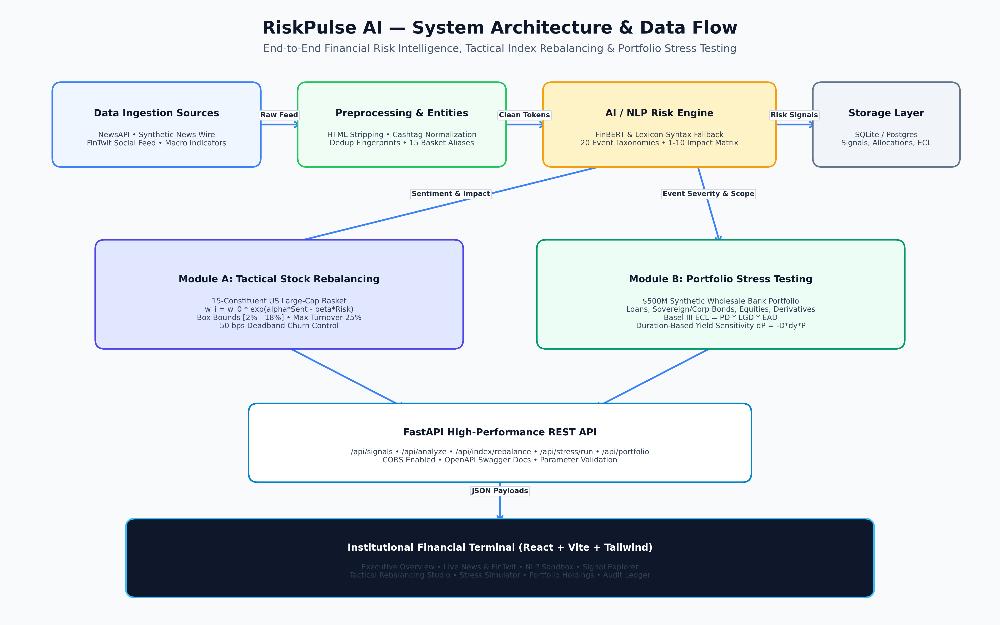

# RiskPulse AI - S&P Global & Crisil Campus Hackathon

**Candidate Name:** Milind Verma  
**College Email ID:** [milind.23bce11695@vitbhopal.ac.in](mailto:milind.23bce11695@vitbhopal.ac.in)  
**College / Campus:** VIT Bhopal University  
**Demo Video Link:** [YouTube / Unlisted]

---

## 1. Project Overview / Problem Statement & Approach

Modern financial institutions, asset managers, and credit rating agencies process vast volumes of unstructured information daily, ranging from breaking news wires and corporate earnings releases to central bank speeches and macroeconomic social discourse. Traditional sentiment tools provide isolated polarity scores (+1/-1) without explainable risk evidence, event classification, or direct quantitative linkages to portfolio capital. Consequently, institutional risk committees and index providers struggle to rapidly quantify how qualitative narrative shocks propagate into constituent exposures, credit default risks, and sector concentration.

RiskPulse AI bridges the gap between unstructured text and quantitative risk management. The platform establishes an end-to-end financial risk intelligence pipeline: unstructured financial text is ingested across multi-source adapters, normalized, deduplicated, and passed through an AI/NLP Risk Engine. The engine combines financial sentiment analysis (FinBERT with transparent Loughran-McDonald lexicon-syntactic fallback), an extensible 20-category event taxonomy, entity extraction, and multidimensional 1–10 impact scoring. Every generated signal is explainable, fully structured, and persisted for auditability.

Rather than stopping at sentiment visualization, RiskPulse AI automatically translates these structured risk signals into two institutional downstream workflows: (1) **Tactical Index Rebalancing**—dynamically adjusting constituent allocations under strict box constraints, 1-way turnover limits ($\frac{1}{2}\sum |\Delta w|$), and sector caps; and (2) **Strategic Portfolio Stress Testing**—evaluating event-driven macro and credit shocks against a $500M synthetic multi-asset wholesale banking portfolio (loans, bonds, equities, derivatives) under Basel III and IFRS 9 Expected Credit Loss (ECL) frameworks.

---

## 2. Architecture & Tech Stack

### Standardized Repository Structure (`vit-bhopal-university-milind-verma-hackathon`)

```text
vit-bhopal-university-milind-verma-hackathon/
├── README.md          <-- Overview, setup steps, architecture & demo link
├── requirements.txt   <-- Dependencies (or package.json / pom.xml)
├── LICENSE            <-- Mandatory (MIT recommended; repo must be public)
├── src/               <-- Application, data pipelines, and model source code
├── data/              <-- Sample or synthetic dataset used for demo
└── docs/
    ├── presentation.pdf <-- 5–7 slide presentation deck
    └── architecture.png <-- High-resolution architecture diagram
```

### System Design & Data Flow
The platform implements a transparent, modular data flow that transforms raw narrative text into structured risk signals and executes downstream portfolio simulations:



1. **Ingestion & Normalization:** Multi-source ingestion layer capturing news articles (NewsAPI, synthetic news wire) and financial social feeds (FinTwit discourse, cashtag monitoring) with SHA-256 deduplication and ticker entity resolution.
2. **AI/NLP Risk Engine:** Hybrid FinBERT financial model and deterministic Wall Street lexicon fallback analyzing sentiment (-1.0 to +1.0), classifying events across 20 financial taxonomies, and computing multidimensional impact scores (1 to 10).
3. **Structured Signal Persistence:** Validated Pydantic schemas and SQLAlchemy models persisting complete audit records, evidence tokens, and provenance flags.
4. **Downstream Decision Engines:**
   - **Tactical Index Rebalancing (Module A):** Constrained quadratic allocation optimizer adjusting constituent weights based on aggregated sentiment and risk penalties with 1-way turnover limits.
   - **Strategic Portfolio Stress Testing (Module B):** Multi-asset stress simulator applying targeted shocks to corporate loans, sovereign/corporate debt, equities, and derivatives ($ECL = PD \times LGD \times EAD$).
5. **Interactive Institutional Interface:** High-performance React 19 + TypeScript frontend with 11 analytical dashboards and a dedicated product landing page strictly following the monochrome institutional design system (`DESIGN.md`).

### Tech Stack
- **Backend & APIs:** Python 3.11+, FastAPI, Pydantic v2, Uvicorn
- **Quantitative & Data Science:** NumPy, Pandas, SciPy, Scikit-Learn
- **Natural Language Processing:** FinBERT (`ProsusAI/finbert` via Hugging Face Transformers), Loughran-McDonald & Wall Street Domain Syntactic Grammar Fallback
- **Database & Persistence:** SQLAlchemy 2.0, SQLite (development) / PostgreSQL (production compatible)
- **Frontend & Visualizations:** React 19, TypeScript, Vite, Tailwind CSS, Recharts, Lucide React
- **Testing & Verification:** Pytest, HTTPX, FastAPI TestClient (19 automated tests, 100% pass rate)
- **Deployment & Tooling:** Docker, Docker Compose, ReportLab, Matplotlib

---

## 3. Dataset Used

### Source & Nature of Data
- **Financial News Feed:** Multi-source news adapter supporting real-time external APIs (NewsAPI, Finnhub) paired with a comprehensive reproducible 100+ record synthetic financial news dataset (`data/synthetic/synthetic_news.json`).
- **Social Media Discourse:** Simulated FinTwit / StockTwits cashtag streams and macroeconomic trader sentiment discussions (`data/synthetic/synthetic_social.json`).
- **Simulated Stock Index Basket:** 15 diversified large-cap constituents (`AAPL`, `MSFT`, `NVDA`, `AMZN`, `JPM`, `XOM`, `CAT`, `PFE`, etc.) with sector classifications and baseline market weights (`data/synthetic/index_constituents.json`).
- **Synthetic Wholesale Banking Portfolio:** A $500M multi-asset credit and investment portfolio comprising Corporate Loans, Government Bonds, Corporate Bonds, Equity Holdings, Interest Rate Swaps, and Cash across 7 global industry sectors and 4 geographic jurisdictions.
- **Sample Benchmark Headlines:** Curated ground-truth test suite (`data/sample/sample_headlines.json`) covering corporate earnings, geopolitical escalation, interest rate shocks, and credit events.

### Assumptions Made
- **Zero Confidential Client Data:** 100% synthetic corporate identifiers, simulated balance sheet exposures, and authorized public financial observations. No real proprietary S&P Global or CRISIL data is used.
- **Financial Calibration:** Portfolio shock elasticities and loss-given-default assumptions are modeled in accordance with standard Basel III capital adequacy guidelines and IFRS 9 staging rules.
- **Deterministic Offline Fallback:** When external APIs or GPU environments are unavailable, the system deterministically falls back to its local pre-seeded datasets and rule-based lexicon engines without degrading user experience or failing tests.

---

## 4. Quickstart & Installation

Runtime: **Python 3.11+ / Node.js 20+** on **macOS (Apple Silicon / Intel), Ubuntu / Linux, or Windows (WSL2)**

Step-by-step commands to set up the environment and run your code locally:

```bash
# 1. Clone the repository
git clone https://github.com/Milindverma24/vit-bhopal-university-milind-verma-hackathon.git
cd vit-bhopal-university-milind-verma-hackathon

# 2. Install dependencies from repo root
pip install -r requirements.txt

# 3. Run the backend application (starts on http://127.0.0.1:8000)
python run.py

# 4. In a separate terminal, launch the React frontend (starts on http://localhost:5173)
cd frontend
npm install
npm run dev
```

### Alternative Execution Methods

#### Standard Direct Entry Points:
```bash
# Backend via Uvicorn
uvicorn src.main:app --host 127.0.0.1 --port 8000 --reload

# Frontend via Vite
cd frontend && npm run dev
```

#### One-Command Docker Deployment:
```bash
docker-compose up --build
```

#### Run Automated Test Suite:
```bash
# Executes all 19 unit & regression tests with 100% pass rate
python run.py --test
# or directly via pytest: pytest -v backend/tests
```

### Key Application URLs:
- **Web Application & Landing Page:** `http://localhost:5173`
- **Executive Overview Dashboard:** `http://localhost:5173/dashboard`
- **Interactive Swagger API Docs:** `http://127.0.0.1:8000/docs`
- **System Health Status:** `http://127.0.0.1:8000/api/health`

---

## 5. Key Results & Domain Impact

### What the Prototype Demonstrates
- **Sub-Second NLP Risk Inference:** Converts unstructured financial text into structured risk signals (`sentiment_score`, `event_type`, `impact_score`, `evidence`, `explanation`) in under 200ms.
- **Constraint-Aware Tactical Rebalancing:** Dynamically recalibrates constituent allocations based on sentiment signals and risk penalties while strictly adhering to 1-way turnover constraints ($\frac{1}{2}\sum |\Delta w|$), single-stock bounds ($1\% \le w_i \le 20\%$), and total weight normalization ($\sum w_i = 1.0$).
- **Multi-Asset Portfolio Stress Testing:** Simulates geopolitical escalation, inflation spikes, and interest rate hikes across a wholesale banking portfolio, calculating baseline vs. stressed valuation, percentage fallout, and sector loss attribution with incremental IFRS 9 ECL adjustments.
- **Explainable & Auditable Intelligence:** Every risk signal and portfolio recalculation produces transparent evidence tokens, mathematical rationales, and timestamped audit logs.
- **Production-Quality Institutional UI:** Features a complete product landing page and 11 specialized dashboards built with an editorial monochrome aesthetic designed specifically for financial risk professionals.

### Domain & Business Impact
- **Operational Efficiency for Analysts:** Replaces hours of manual news screening with automated, structured event classification and early-warning alerts for credit rating and research teams.
- **Direct Linkage from Text to Capital:** Bridges qualitative narratives directly to quantitative balance sheet impacts, enabling chief risk officers and portfolio managers to stress-test assets before market shocks materialize.
- **Regulatory Governance & Compliance:** Transparent scoring rationales and persistent audit trails align with regulatory explainability standards (Basel BCBS 239 and SEC guidelines), preventing "black-box" algorithmic risk exposure.

---

## Additional Technical Documentation
For deeper technical specifications, refer to the dedicated documentation files:
- [System Architecture Specification](docs/architecture.md)
- [Financial & NLP Calculation Methodology](docs/methodology.md)
- [Data Sources & Ingestion Protocols](docs/data_sources.md)
- [Known Limitations & Future Roadmap](docs/limitations.md)
- [Evaluation & Demonstration Walkthrough Script](docs/demo_script.md)
- [Visual Design System Specification](DESIGN.md)

